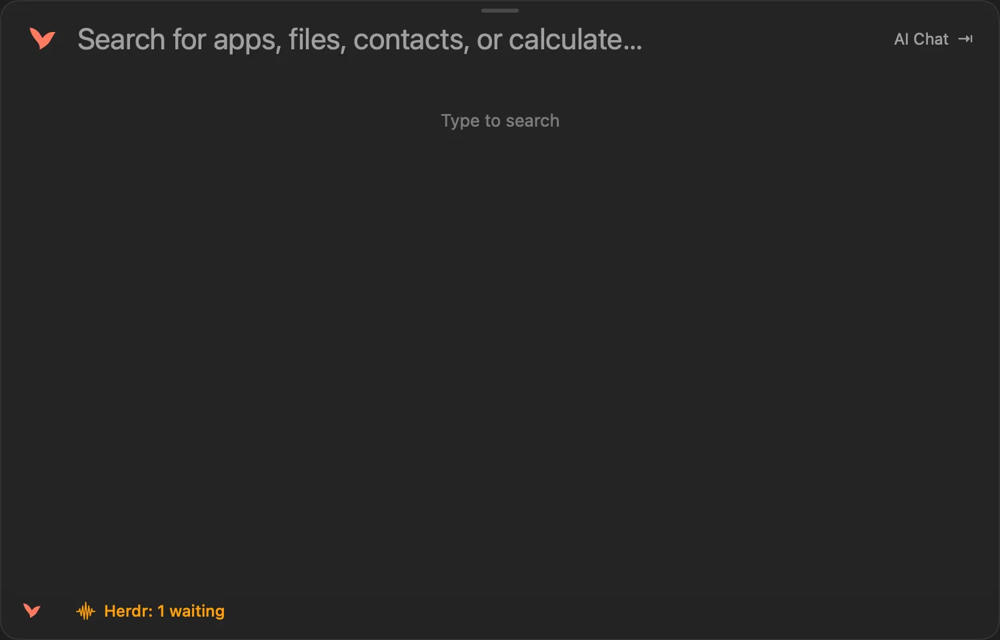

# Volant

**A private, open-source launcher for macOS.** Find apps and files, do math and conversions, keep notes and clipboard history, and keep your coding agents moving, all from one shortcut. A free, MIT-licensed alternative to Raycast, Alfred and Spotlight.

**[Download Volant](https://usevolant.com)** · macOS 15 or later on Apple silicon · about 9 MB · signed and notarized, updates through Sparkle

    brew install --cask mysticcoders/tap/volant

Or **[try it in your browser](https://usevolant.com/try)** first: the calculator and extensions there are Volant's real code compiled to WebAssembly.

## Highlights

- **Launcher:** fuzzy app search that learns from your picks, file search, contacts, today's calendar, per-app hotkeys and aliases.
- **Answers inline:** calculator, unit and currency conversion, time zones, emoji, snippets and quicklinks.
- **Notes and clipboard:** plain Markdown notes with a live editor, and clipboard history encrypted at rest.
- **Agents:** see Claude Code and Codex sessions waiting on you through Herdr or Rex, answer supported questions, and run ACP conversations from the launcher.
- **Mac controls:** audio devices, volume, Wi-Fi, Bluetooth, and the local dev servers you're running.
- **Extensions:** WebAssembly extensions from a signed catalog, run in a separate sandboxed helper with only the hosts and permissions you approve.
- **Coming from Raycast?** Import snippets, quicklinks, aliases, hotkeys and notes from a Raycast export.

## Why it's different

- **The main app has no network access.** It runs in the App Sandbox without the network entitlement. Anything that needs the network, such as exchange rates, extension fetches, AI providers and updates, goes through a separate signed helper with a narrow API.
- **Extensions can't reach the network either.** An extension is a WebAssembly module in its own sandboxed process. It asks for URLs; Volant fetches them only from hosts you approved and hands back the response.
- **Permissions are asked on first use, never at launch.** No Input Monitoring, and no Accessibility unless you turn on Type at the cursor or Search Menu Items, which run in a separate helper.
- **No account, no telemetry.** Clipboard history is encrypted with a key in your Keychain, and notes are plain Markdown files.

The details, including which helpers run outside the sandbox and why, are in [security posture](docs/security-posture.md).

## A quick tour

| Type | To |
| --- | --- |
| `saf` | Launch Safari; Volant learns your picks |
| `12% of 840`, `5 km in mi`, `100 usd in eur` | Get an answer; Return copies it |
| `3pm Lisbon in Tokyo` | Convert times between zones |
| `/report`, `@sam` | Search files or contacts |
| `clip`, `note`, `snip` | Clipboard history, notes and snippets |
| `agents`, `rex`, `acp` | See agents waiting on you, or start an ACP conversation |
| `audio`, `wifi`, `volume 40%`, `servers` | Control your Mac and see local dev servers |
| `hn`, `weather`, `github` | Run an extension from the catalog |

Everything else, from hotkeys to Raycast import, is in [using Volant](docs/usage.md).

## Extensions

The [extension catalog](https://github.com/mysticcoders/volant-extensions) has more than 25 extensions, including Hacker News, GitHub, Weather, Todoist, npm, PyPI and Stack Overflow. Install them from Settings → Extensions. Each one runs only after you approve it and the hosts it reads.

Extensions can be written in Rust, TypeScript or Python from a template. See [contributing](CONTRIBUTING.md#write-an-extension) and the [extension docs](docs/extensions.md).

## Build from source

    Scripts/build.sh     # debug build to build/Build/Products/Debug/Volant.app
    Scripts/test.sh      # tests for the parts you changed
    Scripts/install.sh   # release build to /Applications/Volant.app

Requires Xcode 26 and xcodegen (`brew install xcodegen`). The project is generated from `project.yml`. Sparkle is the only third-party dependency.

## Contributing

Bug reports, ideas and pull requests are welcome. Start with [CONTRIBUTING.md](CONTRIBUTING.md), the [good first issues](https://github.com/mysticcoders/volant/labels/good%20first%20issue), or [Discussions](https://github.com/mysticcoders/volant/discussions).

## License

MIT. Volant was previously named Vey; see [rename decisions](docs/volant-rename.md).
