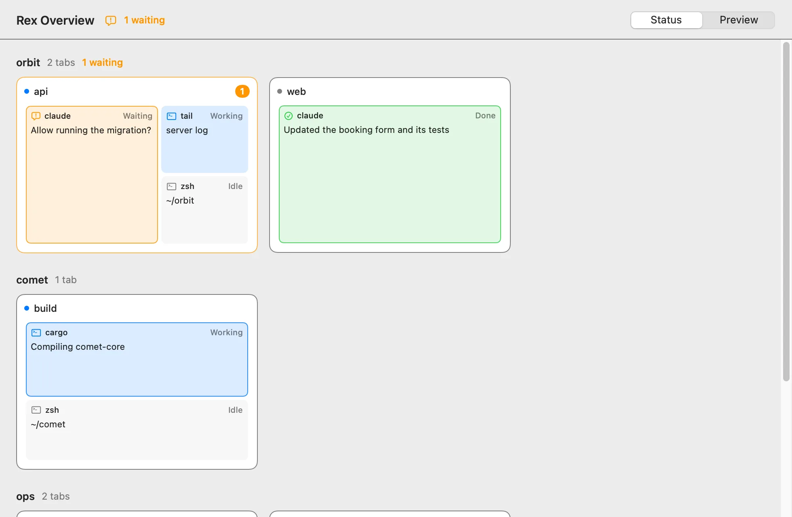
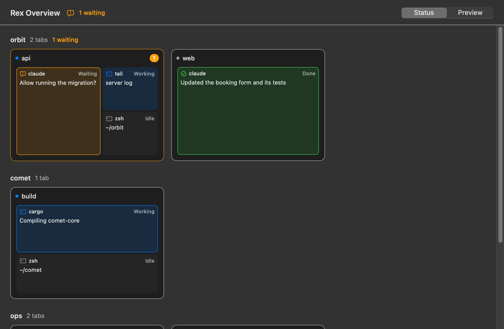
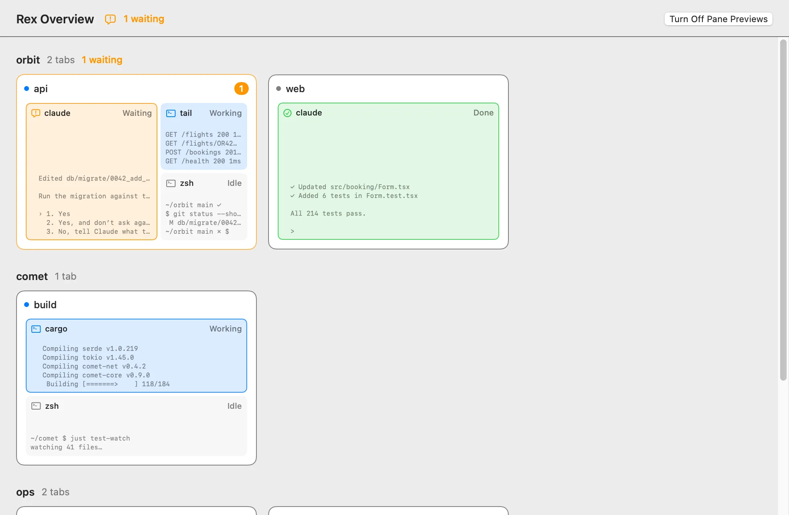
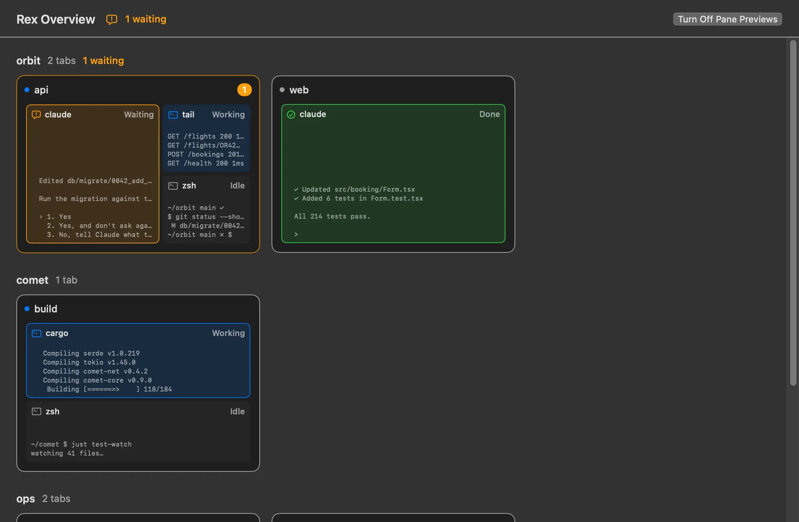
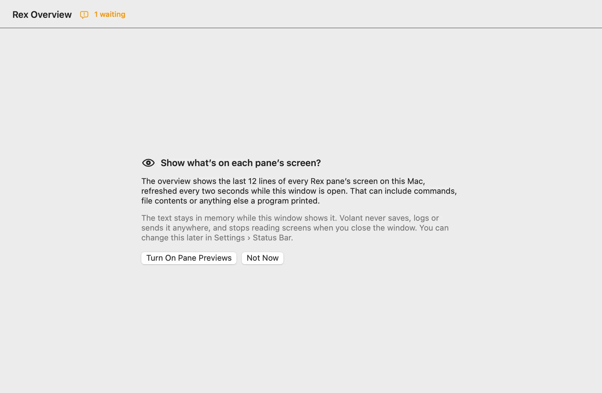
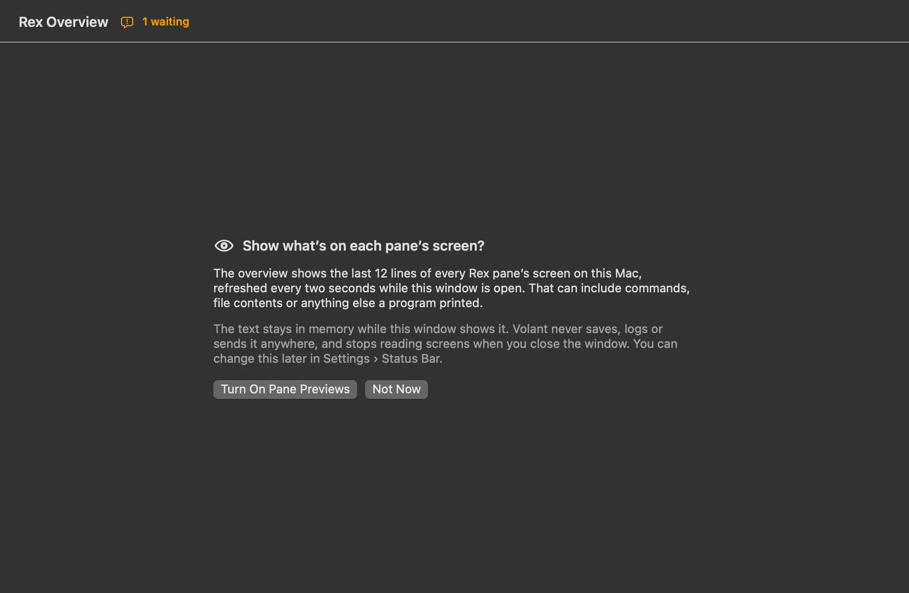

# Rex Overview spike — October 21, 2026

Status: spike on `rex-overview-spike`, not released. It compares a status-only overview of every Rex
session with an opt-in pane preview. Checked against Rex `0.0.1792519967-gd05acf`, server API
revision 4. Builds on [Rex integration](rex-integration.md).

## What it is

A separate **Rex Overview** window, opened from the `rex` list (Open Rex Overview follows the panes)
or by typing `rex overview`. Every session is a group; every tab is a card that draws its panes where
they sit in Rex, from each pane's `rect` in the tab's layout. Pane tiles are native buttons that
focus the pane in Rex through the existing `focusRexPane`. The tab Rex shows is marked, and waiting
panes are counted per tab, per session and in the header.

A **Status / Preview** switch changes every tile:

- **Status:** program, state and the last status message (or the terminal title).
- **Preview:** the same heading with the last 12 lines of the pane's screen text. The first time,
  a consent card says what this reads; the choice is kept per Mac and can be turned off from the
  header.

| | Light | Dark |
| --- | --- | --- |
| Status |  |  |
| Preview |  |  |
| Consent |  |  |

Rendered by the native Actions fixture (`rex-overview` scenario) in headless Tart with fictional
sessions and invented screen text, at 980×640.

## What Rex provides for it

- **Layout:** `session.view` gives each tab's panes as a split tree whose leaves carry `rect`, as
  `[x, y, w, h]` fractions of the tab. No split arithmetic is needed. Floating layers are skipped
  in the spike.
- **Names:** Rex names new tabs "Window" plus a short ID, so such a tab is named for its focused
  pane: its terminal title (`title`), then folder, then program.
- **Program:** `process` returns the foreground process without arguments ("Rex never returns the
  other arguments, because they can hold secrets"). Claude Code's process `name` is its version
  (`2.1.305`), so the label follows Rex's guidance: `script`, then `argv0`, then `name`, as a file
  name without a login shell's dash.
- **Screen text:** `format` with `format: "text"` returns the screen **and the whole scrollback**;
  there is no visible-screen-only option. Measured on the owner's 15 panes: about 100 KB in total,
  13 KB at most, in about 250 ms for all of them including process start. A shell with long history
  would cost more.

## How previews are kept narrow

- The watcher reads screen text only when started with `--args {"preview":true}`, and only an
  overview read in Preview mode with previews allowed asks for that. It refreshes previews every
  2 s; status-only snapshots stay on events plus a 30 s heartbeat.
- The script keeps the last 12 non-blank lines of 160 characters before printing; `RexOverview.parse`
  cuts and flattens them again.
- The helper switches back to a status-only watcher within 5 s of the last preview read, or at once
  when an overview reads without previews, and drops its cached overview when it does.
- The app strips previews from anything it shows unless it is in Preview mode with previews
  allowed, clears them on leaving Preview, and forgets everything when the window closes.
- Preview text is never logged or persisted. The `rex` list never receives it.
- `tools/check-rex.sh` checks the watcher's arguments on each mode switch; `RexOverviewModelTests`
  checks the app never shows screen text without both conditions.

## Findings

1. **Status reads at a glance.** Waiting and failed panes stand out by color, and the drawn layout
   makes tabs recognizable without previews. This is enough for "which tab needs me".
2. **Previews add real context** (the actual question, build progress, the last log lines), which
   status messages only summarize. They help most for programs that report no status at all.
3. **Previews need room.** Panes in split tabs show four or five lines at this size; long lines wrap,
   which reads less like a terminal than cutting each line at the edge would.
4. **Privacy cost is real.** Previews read every pane's full scrollback every two seconds while
   showing. That needs the explicit opt-in this spike asks for, and AGENTS.md, the privacy docs and
   marketing claims would need updating before it ships.
5. **Remote Control still governs session switching** when a tile is clicked, as in the `rex` list.

## Not in the spike

- Keyboard navigation between tabs and panes; tiles are clickable only.
- Floating panes and zoomed panes.
- A setting in Settings for previews; the choice lives in the window and in this Mac's user defaults
  (`rexOverviewPanePreviews`) rather than `config.json`.
- Live verification in an installed build, including the owner's real panes in Preview mode.

## Evidence

- `RexOverviewTests` (Core): tabs from windows, rects, program names, tab names, waiting and primary
  pane, bounded and flattened previews, clamped rects, malformed IDs and rects, empty Lua tables.
- `RexOverviewModelTests` (app): screen text needs both the opt-in and Preview mode, is dropped on
  leaving Preview and on close, and the choice is remembered per Mac.
- `RexInventoryTests`: the watcher reads screens only inside its preview branch, in plain text.
- `tools/check-rex.sh`: preview mode switching of the real `RexWatch` against fake `rex` scripts.
- Native Actions fixture `rex-overview` scenario, light and dark, inspected.
- Live status-mode parse against the owner's Rex: 6 sessions, 15 tabs, rects and titles for every
  pane, no previews.
